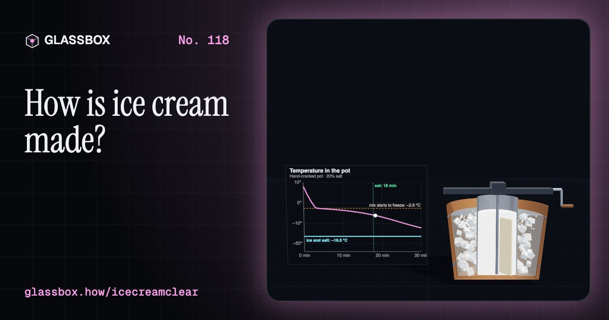
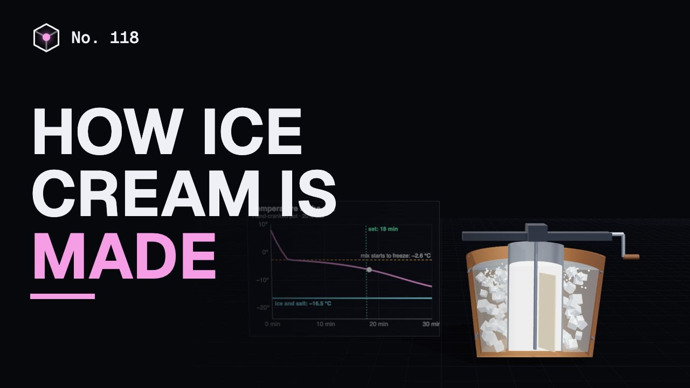
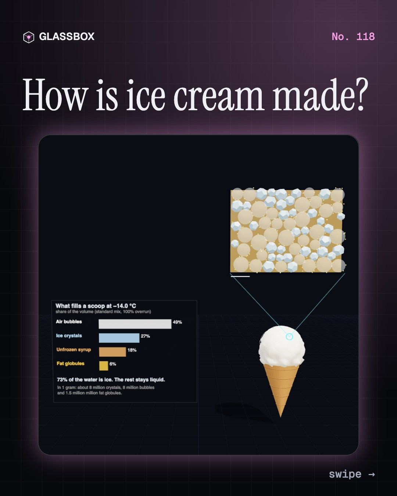
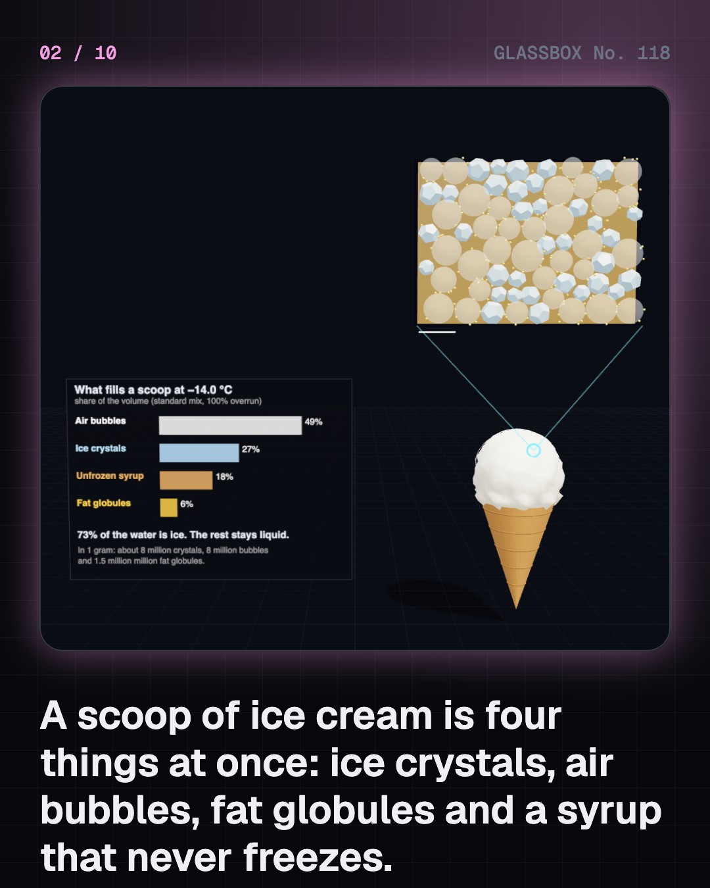
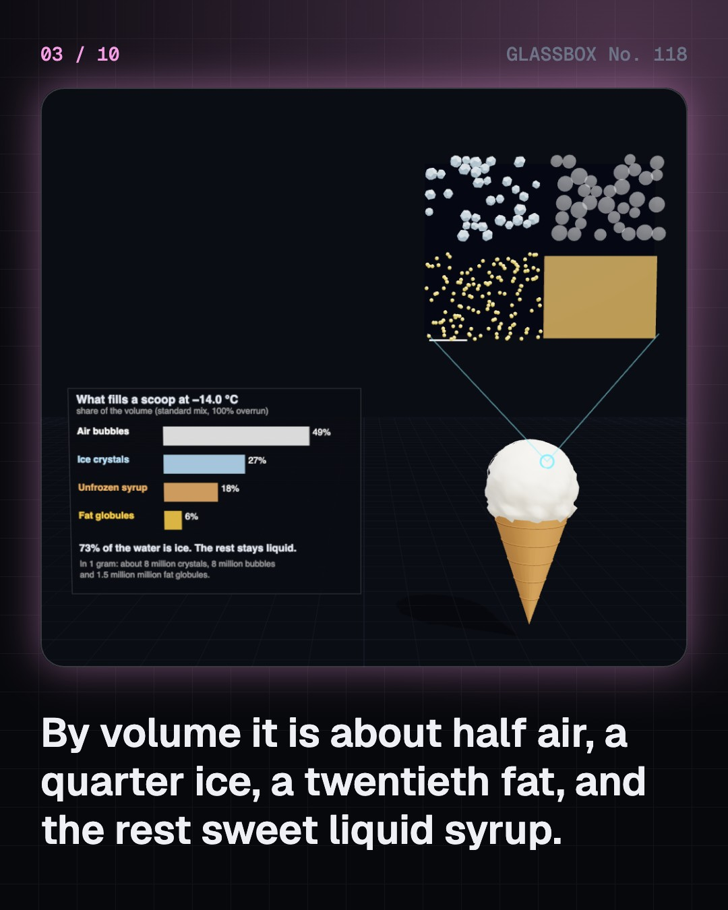
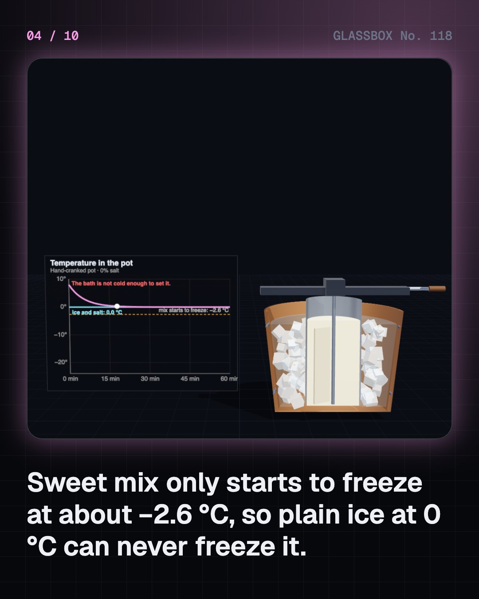

<!-- glassbox:start -->
<!-- Generated from glassbox.json by the Glassbox hub (npm run readme -- icecreamclear). Edit glassbox.json, not this block. -->
<p align="center"><a href="https://glassbox.how/e/icecreamclear/"></a></p>

<h1 align="center">IceCreamClear</h1>

<p align="center"><b>How is ice cream made?</b><br>A scoop of ice cream is half air. The rest is millions of ice crystals, tiny balls of fat and a syrup that never freezes. Pull a scoop apart, chill a pot with salt and ice, spin the scraper blades, whip in the air, design your own scoop, and see why kulfi melts slowly and a thawed tub turns icy.</p>

<p align="center"><a href="https://glassbox.how/icecreamclear/"><b>▶ Play with it</b></a> &nbsp;·&nbsp; <a href="https://glassbox.how/e/icecreamclear/">Read the 60-second explainer</a> &nbsp;·&nbsp; <a href="https://glassbox.how/icecreamclear/glassbox/reel.mp4">Watch the 40-second video</a></p>

<p align="center">
  <a href="https://glassbox.how/e/icecreamclear/"></a>
  <a href="https://glassbox.how/e/icecreamclear/"></a>
  <a href="LICENSE"></a>
  <a href="LICENSE-CONTENT.md"></a>
  <a href="#privacy"></a>
</p>

## In 60 seconds

1. **A scoop is four things at once.** Under a microscope, ice cream is ice crystals about 50 micrometres across, air bubbles a little bigger, fat globules about 1 micrometre across, and a thick sugar syrup that is still liquid. By volume a typical scoop is about half air, a quarter to a third ice, a twentieth fat, and the rest syrup.
2. **Salt makes ice colder than ice.** Sweet mix only starts to freeze at about −2.6 °C, so plain ice at 0 °C can never freeze it. Salt makes the ice melt, and melting takes heat from the pot itself. Ice and salt can reach −21 °C. That is how a hand-cranked pot and a kulfi matka work.
3. **Freeze fast and scrape the wall.** Big crystals feel icy: the tongue notices them above about 50 micrometres. A freezer barrel chilled to about −30 °C starts crystals quickly, and spinning blades scrape them off the wall as tiny seeds. The ice cream leaves at about −5 °C with half its water frozen, then is hardened in a blast freezer.
4. **Half of it is air.** The dasher whips air in as it scrapes. Overrun is the extra volume: at 100% the mix has doubled, so half of every scoop is air. Clumps of part-solid milk fat brace each bubble. In India, FSSAI requires a litre of ice cream to weigh at least 525 grams, which caps the air.
5. **Sugar is the antifreeze.** Sugar lowers the freezing point, and as ice forms the syrup left behind gets stronger. So the water never all freezes: about a quarter is still liquid at −14 °C. That is why a spoon goes in. Sugar, fat, air and serving temperature together decide how firm, smooth and long-lasting a scoop is.
6. **Kulfi, gelato and the refreeze problem.** Kulfi is thick, slow-boiled milk frozen without churning, so it holds almost no air and melts slowly. Gelato has less fat and air, and soft serve is never hardened. A product made with vegetable fat must be labelled frozen dessert. Each time a tub warms up, its small crystals melt and the big ones grow, so it turns icy.

## Words worth knowing

| Term | Meaning |
|---|---|
| **Overrun** | The air whipped into ice cream, given as extra volume. 100% overrun means the mix doubled in volume. |
| **Freezing-point depression** | Dissolved sugar or salt lowers the temperature at which water freezes. |
| **Eutectic point** | The lowest freezing point of a salt and water mixture: −21.1 °C at 23.3% common salt. |
| **Scraped-surface freezer** | A chilled barrel whose blades shave ice off the wall as fast as it forms, while a dasher whips in air. |
| **Partial coalescence** | Part-solid fat globules sticking together in clumps without merging. The clumps hold the air bubbles. |
| **Freeze concentration** | As ice forms, the sugar is left in less water, so the remaining syrup gets ever harder to freeze. |
| **Recrystallisation** | Small ice crystals vanishing and large ones growing during storage, which makes old ice cream icy. |
| **Kulfi** | Slow-reduced, sweetened milk frozen in moulds without churning. Dense, with almost no air. |
| **Frozen dessert** | Under FSSAI rules, a product like ice cream made with vegetable fat instead of milk fat. It must be labelled as such. |

## A short history

**2,400 years from desert ice houses to a factory barrel that freezes a scoop in thirty seconds.**

- **1590** · Saltpetre, mountain ice and the Mughal court (Abu'l-Fazl, at Akbar's court, Lahore, Agra and Delhi, Mughal India)
- **1650** · Salt on ice: the freezing mixture reaches Europe's kitchens (Cooks and natural philosophers, Italy, France and England)
- **1694** · Sorbetti in print, one of them made with milk (Antonio Latini, Naples, Italy)
- **1843** · The hand-cranked freezer is patented (Nancy M. Johnson, Philadelphia, USA)
- **1851** · Ice cream becomes a factory product (Jacob Fussell, Seven Valleys, Pennsylvania, and Baltimore, USA)
- **1885** · The queen of ices (Agnes B. Marshall, London, England)
- **1904** · The cone, and a contest over who invented it (Italo Marchiony, Ernest Hamwi and others, New York and St. Louis, USA)
- **1907** · Kothi ice cream in Ahmedabad (Vadilal Gandhi, Ahmedabad, India)

The full story, with 29 moments, charts, people and 32 sources: [glassbox.how/e/icecreamclear/history](https://glassbox.how/e/icecreamclear/history/). The data lives in [`history.json`](history.json).

## Video and slides

Made with the Glassbox studio from this box's storyboard (`window.glassbox.director`). Free to reuse under CC BY 4.0.

<a href="https://glassbox.how/icecreamclear/glassbox/video.mp4"></a>

<p><a href="glassbox/slide-1.jpg"></a> <a href="glassbox/slide-2.jpg"></a> <a href="glassbox/slide-3.jpg"></a> <a href="glassbox/slide-4.jpg"></a></p>

| File | What | Size |
|---|---|---|
| [`glassbox/reel.mp4`](https://glassbox.how/icecreamclear/glassbox/reel.mp4) | Reel / Short, with captions and soundtrack | 1080×1920 |
| [`glassbox/video.mp4`](https://glassbox.how/icecreamclear/glassbox/video.mp4) | YouTube video, with captions and soundtrack | 1920×1080 |
| `glassbox/slide-1…10.jpg` | Instagram carousel | 1080×1350 |
| `glassbox/thumb.jpg` | YouTube thumbnail | 1280×720 |
| `glassbox/cover.jpg` | Share card and repo social preview | 1200×630 |
| [`glassbox/history-reel.mp4`](https://glassbox.how/icecreamclear/glassbox/history-reel.mp4) | “History in 10 moments” Reel / Short | 1080×1920 |
| `glassbox/history-slide-*.jpg` | History carousel | 1080×1350 |
| `glassbox/post.json` | Post copy and schedule used by the publish kit | |

## Privacy

This box has no accounts and no ads, and it ships its own fonts and libraries. When you run it yourself it sends nothing anywhere. On glassbox.how, the site's `/bar.js` also loads Glassbox's analytics: **Google Analytics** to count visits (it asks first in the EU, UK and Switzerland, and stays off when your browser sends Global Privacy Control or Do Not Track) and **ClickTrust** to detect bots.

It remembers a few things **in your own browser only**, and never sends them anywhere:

| Browser storage key | What it holds |
|---|---|
| `icecreamclear.v1` | Which chapters you have opened, your best quiz scores, and sound on or off. |

Exactly what each one sees is at [glassbox.how/privacy](https://glassbox.how/privacy/).

## Licences

- **Code:** [MIT](LICENSE). Use it, change it, ship it.
- **Explanations, text, images and videos** (`glassbox.json`, `glassbox/`): [CC BY 4.0](LICENSE-CONTENT.md). Credit “Glassbox, glassbox.how/e/icecreamclear”.
- **Third-party parts** keep their own licences: [three.js](https://threejs.org) (MIT), [Geist, Instrument Serif](https://openfontlicense.org) (SIL OFL 1.1).
- The Glassbox name and logo aren't covered by either licence. See the [terms](https://glassbox.how/terms/).

Found a mistake? [Open an issue](https://github.com/bdeeps/icecreamclear/issues). Corrections happen in public.
<!-- glassbox:end -->

## Run it

It's plain HTML, CSS and JavaScript. No build step and no dependencies. Run locally, it contacts no other website.

```bash
python3 -m http.server 8000
```

Three.js and the fonts ship in `vendor/` and `fonts/`, so it also works offline.

Then open http://localhost:8000.

## How it's built

| File | What |
|---|---|
| `index.html`, `css/app.css` | The page and its styles |
| `js/app.js`, `js/stage.js`, `js/ui.js`, `js/kit.js` | The shared Glassbox 3D engine: chapters, 3D stage, controls, quiz, video director |
| `js/chapters/*.js` | One file per chapter: the 3D model, controls, text, key terms, quiz and video scenes |
| `js/physics.js` | The numbers and models with no 3D in them: the freezing curve of a mix, salt-and-ice bath temperature, overrun and weight, crystal size, heat shock, melting time |
| `js/icecream.js` | Shared drawing helpers: the microscope view of crystals, bubbles, fat and syrup, the chart boards and the screen layout |
| `glassbox.json` | Title, question, explainer beats, key terms, browser storage and credits shown on glassbox.how |
| `reel` in each chapter | The storyboard the Glassbox studio records into short videos |
| `glassbox/` | The published video, slides, thumbnail and post copy |
| `fonts/`, `vendor/three/` | Self-hosted Geist and Instrument Serif (SIL OFL 1.1) and three.js (MIT) |
